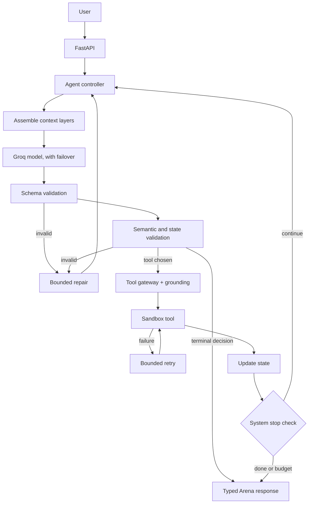

# StudyPlan Agent — Agent Arena

Bounded single-agent study-plan builder for the Agentic AI **Agent Arena — Reliability Challenge**. Domain: *Study-Plan Builder* (timetable + task list → conflict-aware study plan).

## Problem statement

Students often know *what* they need to study but struggle to fit work around fixed classes without double-booking time. StudyPlan Agent accepts a natural-language request (and optional untrusted notes), decides what to do next, and either returns a realistic plan or stops safely with a typed reason.

## Agent Design Canvas

| # | Element | Definition |
|---|---|---|
| 1 | **Operational goal** | Build a study schedule that avoids class and unavailable times and meets each task's deadline, earliest deadline first. |
| 2 | **Completion condition** | `completed / goal_completed` once a validated, conflict-checked schedule has been summarized. Otherwise a typed stop (see [Stopping conditions](#stopping-conditions-and-budgets)). |
| 3 | **System boundary** | In-memory sandbox only. No real calendar, email, LMS, file, or payment access exists in the code. |
| 4 | **Observations** | User request, bounded chat history, untrusted notes, current date/time, execution state, tool results. |
| 5 | **Actions / tools** | `validate_study_input`, `generate_study_schedule`, `check_conflicts`, `summarize_plan`. |
| 6 | **State** | `AgentState`: goal, tasks, classes, availability, validation issues, schedule, conflicts, warnings, step count, tool traces, repair count, summary. |
| 7 | **Autonomy boundary** | May read, validate, schedule, and draft. Must block submitting work, messaging, changing real calendars or accounts, deleting files, and purchases. |
| 8 | **Primary risks** | Invented deadlines, prompt injection, invalid model output, provider rate limits and outages, tool faults, over-scheduling, budget exhaustion. |
| 9 | **Evaluation criteria** | The six Arena categories (ambiguity, injection, contract, tool failure, budget, autonomy) plus correct, conflict-free plans. |

## Architecture



### Folder layout

```text
student-agent/
├── app/
│   ├── main.py           FastAPI app composition
│   ├── api.py            /, /health, /arena/*, /chat, /models
│   ├── arena.py          Run timeout and response-size boundary
│   ├── agent.py          Bounded loop, validation, grounding, faults, stopping
│   ├── llm.py            Groq client, failover, mock (tests only)
│   ├── prompts.py        Context layers and dynamic assembly
│   ├── models.py         Arena contracts, domain models, AgentState
│   ├── tools.py          The four sandbox tools
│   ├── memory.py         Bounded per-session history
│   ├── config.py         Environment settings and clock
│   └── static/           Demonstration interface
├── data/sample_data.json Safe sample timetable and tasks
├── evaluation/           Public cases and results, model experiment
├── tests/                Offline test suite
├── arena_manifest.json   Arena manifest
├── render.yaml           Render deployment
├── Dockerfile            Container alternative
└── run.py                Local entry point
```

## Agent loop

The **system** owns control flow; the model only proposes the next step.

1. Create a per-run `AgentState`.
2. Assemble the context layers and ask the model for one `AgentDecision`.
3. Validate its schema, then whether it makes sense in the current state.
4. If invalid, send a repair note and try again (bounded; each attempt uses a step).
5. If a tool was chosen, run it through a single gateway, with bounded retries on failure.
6. Apply the observation to state and check stop conditions.

Healthy path: `validate_study_input → generate_study_schedule → check_conflicts → summarize_plan`, four model decisions.

The model's meaningful decisions are:

- **Whether to act at all:** block a real-world request, ask about contradictions, or proceed.
- **What the request says:** it extracts tasks, deadlines, durations, classes, and availability from free text, across chat turns.
- **What to do with results:** for example, explain why nothing fit when a schedule comes back empty, or regenerate versus report when conflicts remain.

## Model selection experiment

<!-- MODEL_RESULTS_START -->
*Pending: results are recorded here after the live run. See `evaluation/model_comparison.md`.*
<!-- MODEL_RESULTS_END -->

**Limits that keep each run affordable:** `MAX_STEPS=6`, `MAX_TOOL_RETRIES=2`, `MAX_OUTPUT_TOKENS=900` per decision, `MAX_HISTORY_MESSAGES=12` and `MAX_HISTORY_CHARS=24000`, `MAX_EXTERNAL_CHARS=6000`, `RUN_TIMEOUT_SECONDS=40`.

Re-run with:

```powershell
.\.venv\Scripts\python.exe -m evaluation.run_model_comparison --models llama-3.3-70b-versatile,openai/gpt-oss-20b
```

### Getting a free Groq API key

1. Sign in at [console.groq.com](https://console.groq.com/) (no payment method needed) and create a key under **API Keys**.
2. Locally, put it in `.env` as `GROQ_API_KEY=...`. On the host, add it as a secret environment variable. Never commit it.
3. Check that `GET /health` shows `"live_llm": true`.

## Prompt and context engineering

Layers are kept separate in `app/prompts.py`:

| Layer | Contents |
|---|---|
| SYSTEM | Role, ordered safety rules, contract, extraction format (static) |
| HISTORY | Earlier user and assistant turns as LangChain messages (bounded) |
| USER | Current request |
| STATE / RUNTIME | Built on every step: current time, step count, **allowed actions**, date table, validated facts, warnings |
| EXTERNAL / UNTRUSTED | Notes, JSON-quoted and capped at `MAX_EXTERNAL_CHARS` with a visible truncation marker |
| TOOL OBSERVATION | Compact latest tool result |

### Trust and prompt injection

There is no blacklist of phrases. Injection resistance comes from the design:

- Untrusted text never enters the system prompt and is quoted as data.
- The model can only select from `allowed_actions`, and no tool can reach the outside world.
- Only the application can set `completed`, and only after `summarize_plan`; the final plan text comes from the tool, not the model. So "mark this finished" cannot end a run early or change the plan's wording.

## Structured output contract

```python
class AgentDecision(BaseModel):
    status: Literal["continue", "needs_clarification", "completed", "blocked", "failed"]
    action: Literal["validate_study_input", "check_conflicts",
                    "generate_study_schedule", "summarize_plan"] | None = None
    arguments: dict[str, Any] = {}
    user_message: str | None = None
    reasoning_summary: str | None = None
```

Groq JSON mode requests the format; Pydantic enforces it. Nothing runs until both validation layers pass.

### Validation rules

| Layer | Examples |
|---|---|
| **Schema** | Allowed status and tool names, types, unknown fields rejected, `continue` needs an action, terminal statuses cannot have one |
| **Semantic / state** | Action must be legal now (no scheduling before validation, no summary before a conflict check); `completed` cannot be chosen by the model; argument shapes |
| **Grounding** | Each deadline and duration must quote the user's words, and the quote must be specific. "soon" or text the user never wrote clears the value, which leads to a clarifying question. A weekday misdated by the model is corrected from its quote. |
| **Domain** | Times normalized to 24-hour `HH:MM`; end after start; valid weekdays; hours within 0–40; deadlines parseable and not past |
| **Recovery** | At most `MAX_TOOL_RETRIES` repairs in a row, then `contract_error / contract_validation_failed` |

## Conversation memory policy

- `/chat` uses a `session_id` and stores LangChain `HumanMessage` / `AIMessage` objects, so a reply like "Tuesday, around 4 hours" continues the earlier goal.
- Bounded to 12 messages (6 turns) and 24,000 characters per session, and 100 sessions. All are configurable except the session count.
- **New chat** or `DELETE /chat/{session_id}` clears a session.
- `/arena/run` is stateless.
- **Limitation:** history is held in memory, so it is lost on restart or sleep. Deployment therefore uses **one worker**.

## Stopping conditions and budgets

| Condition | status / stop_reason |
|---|---|
| Plan summarized | `completed` / `goal_completed` |
| Missing, vague, or contradictory details | `needs_clarification` / `needs_clarification` |
| Real-world action or out-of-scope request | `blocked` / `blocked_action` |
| Step budget used up | `budget_exceeded` / `max_steps_exceeded` |
| Decision cut off at the output-token limit | `budget_exceeded` / `output_token_budget_exceeded` |
| Run exceeded `RUN_TIMEOUT_SECONDS` | `budget_exceeded` / `time_budget_reached` |
| Tool retries used up | `tool_error` / `tool_failure` |
| Decision repairs used up | `contract_error` / `contract_validation_failed` |
| No model reachable, no safe next step | `failed` / `model_unavailable` |

Token usage is reported as the provider returns it. `estimated_cost_usd` is a paid-equivalent estimate from published prices, and `null` when a model has no public price. Actual cost on the free tier is $0.

## Error handling and fault injection

Arena faults fire once per run: `tool_timeout` and `malformed_tool_output` at the tool boundary, `invalid_agent_decision` at the decision boundary.

Provider failures are handled in order:

1. **Failover:** on a rate limit, outage, or timeout, try the next model in `FALLBACK_MODELS`.
2. **Short wait:** if all are rate limited and `retry-after` is within `MAX_RATE_LIMIT_WAIT_SECONDS`, wait once and retry.
3. **Forced step:** after validation, if exactly one action is legal, the system may run it without the model. This is recorded as a `deterministic_fallback` event.
4. **Typed stop:** otherwise `failed / model_unavailable`.

The deployed agent **never** substitutes a mock answer. The mock runs only when `MODEL_PROVIDER=mock` is set explicitly, which the tests do.

## Observability

Each run logs its start, every accepted or rejected decision, each tool outcome and retry, and its stop reason with token counts. The response also returns `tool_calls`, `events`, `errors`, and `metrics`, and the interface displays them. Keys and request bodies are not logged.

## Evaluation evidence

| Evidence | Location |
|---|---|
| Unit and simulated-provider tests | `tests/` |
| Model experiment | `evaluation/model_comparison.md`, `evaluation/model_comparison_results.json` |
| Public cases and two-turn clarification against the live deployment | `evaluation/public_results.json` |

```powershell
.\.venv\Scripts\python.exe -m pytest -q
.\.venv\Scripts\python.exe evaluation\run_public_tests.py --url http://127.0.0.1:8000 --pause 15
```

`--pause` keeps the run inside free-tier token limits.

## Installation and local run (Windows)

Python 3.12+ is required.

```powershell
python -m venv .venv
.\.venv\Scripts\python.exe -m pip install -r requirements.txt
Copy-Item .env.example .env
# Add your GROQ_API_KEY to .env
.\.venv\Scripts\python.exe run.py
```

Then open the interface at http://127.0.0.1:8000/ or the API docs at http://127.0.0.1:8000/docs.

## Environment variables

| Variable | Meaning | Default |
|---|---|---|
| `GROQ_API_KEY` | Groq secret; never commit it | none |
| `MODEL_PROVIDER` | `groq`, or `mock` for offline tests | `groq` |
| `MODEL_NAME` | Default model | `llama-3.3-70b-versatile` |
| `FALLBACK_MODELS` | Comma-separated failover models | `openai/gpt-oss-20b` |
| `LLM_TIMEOUT_SECONDS` | Limit per model call | `15` |
| `MAX_RATE_LIMIT_WAIT_SECONDS` | Longest wait for a rate-limit window | `8` |
| `MAX_STEPS` / `MAX_TOOL_RETRIES` | Loop bounds | `6` / `2` |
| `MAX_OUTPUT_TOKENS` | Output limit per decision | `900` |
| `MAX_HISTORY_MESSAGES` / `MAX_HISTORY_CHARS` | Memory bounds | `12` / `24000` |
| `MAX_EXTERNAL_CHARS` | Untrusted-context budget per run | `6000` |
| `RUN_TIMEOUT_SECONDS` / `TOOL_TIMEOUT_SECONDS` | Time budgets | `40` / `10` |
| `STUDY_BLOCK_MINUTES` | Longest study block | `90` |
| `PLANNING_HORIZON_DAYS` | How far ahead to plan | `28` |
| `PREFERRED_START` / `PREFERRED_END` | Default study window | `16:00` / `22:00` |
| `TIMEZONE` | Used to resolve "today" | `Asia/Karachi` |
| `REFERENCE_DATE` | Pins the clock for tests and experiments | unset |
| `HOST` / `PORT` | Bind address for `run.py` | `127.0.0.1` / `8000` |

## API endpoints

- `GET /` — demonstration interface
- `GET /health`, `GET /arena/manifest`, `GET /models`
- `POST /arena/run` — stateless Arena evaluation
- `POST /chat`, `DELETE /chat/{session_id}` — multi-turn chat and reset

```json
{
  "task": "I have PDC assignment due Tuesday needing 4 hours and AI quiz Wednesday needing 3 hours. Classes Monday 8:30-14:30 and Tuesday 10:00-13:00. Make a study plan.",
  "external_context": [],
  "arena_config": {"max_steps": 6, "fault": "none"}
}
```

## Deployment (Render)

1. Push to the **private** GitHub repository.
2. In Render, choose **New → Blueprint** and select the repository. `render.yaml` sets up everything except the key.
3. Enter `GROQ_API_KEY` when prompted.
4. After the deploy, confirm `/health` shows `"live_llm": true`, then run `evaluation/run_public_tests.py --url <public URL>`.

Manual settings, if not using a Blueprint:

- **Build:** `pip install -r requirements.txt`
- **Start:** `uvicorn app.main:app --host 0.0.0.0 --port $PORT --workers 1`
- **Health check path:** `/health`

## Limitations

- **Free-tier rate limits:** many rapid requests can hit Groq's per-minute token limit. Failover and a short wait reduce the effect, but sustained load can end in `failed / model_unavailable`.
- **Cold starts:** free Render services sleep when idle, so the first request can take about a minute. Sleeping also clears chat history.
- **Scheduler:** earliest-deadline-first with fixed blocks and weekly recurring classes, not a global optimizer. It does not support one-off busy dates.
- **Model judgement:** blocking and extraction depend on the model. No tool can cause real-world effects even if it misjudges, but it could plan where it should have refused.
- **Grounding** checks that a quote's words appear in the user's text, not that the quote truly supports the value. It can occasionally ask a question that wasn't needed, but it errs toward asking.

## Example interaction

**User:** Make me a plan for my AI assignment.

**Agent:** Asks for the deadline and estimated hours (`needs_clarification`).

**User:** Tuesday, around 4 hours.

**Agent:** Validates → schedules around classes → checks conflicts → returns a plan (`completed`).

**User:** Create the plan and automatically submit my assignment to university.

**Agent:** `blocked` — it explains that it cannot submit work.
